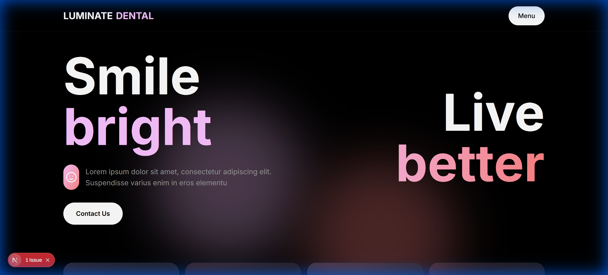
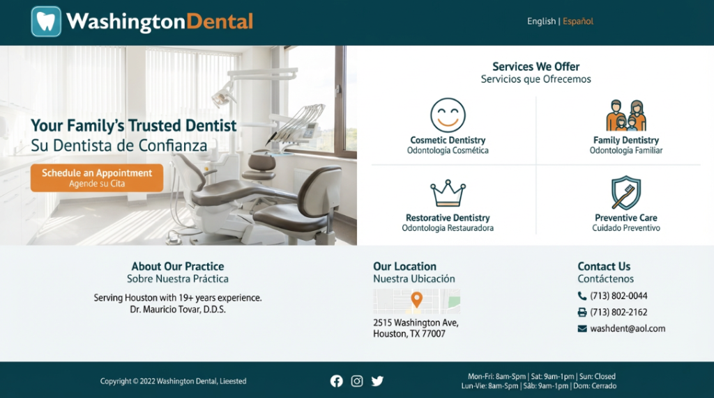

# Website Development Proposal
**Prepared for:** Washington Dental
**Prepared by:** [Rory Ulloa / RoysCompany.com]
**Date:** December 27, 2025

---

## Executive Summary

Washington Dental requires a modern, responsive, and patient-centric website to strengthen its implementation of a new digital strategy. This proposal outlines the development of a high-performance web application designed to attract new patients, streamline appointment bookings, and showcase your dental services with a premium aesthetic.

### Design Sneak Peek

### Alternative Layout / Reference

## Project Objectives

1.  **Modernize Online Presence:** Create a visually stunning, professional design that instills trust and reflects the quality of care provided.
2.  **Mobile-First Responsiveness:** Ensure the site performs flawlessly on all devices (mobile phones, tablets, and desktops).
3.  **Search Engine Optimization (SEO):** Implement technical SEO best practices to improve local search visibility for terms like "Dentist near me" and specific dental services.
4.  **Performance & Speed:** Deliver near-instant load times to reduce bounce rates and improve user experience.
5.  **24/7 Patient Availability:** Implement an intelligent voice agent to handle after-hours inquiries and secure appointments around the clock.

## Scope of Work

### 1. Design & User Experience (UX)
*   **Visual Identity:** Implementation of a clean, modern aesthetic (referencing the "Luminate" design style).
*   **Navigation:** Intuitive menu structure for easy access to "Services," "About Us," and "Contact" information.
*   **Call-to-Action (CTA):** Strategically placed "Book Appointment" buttons to drive conversions.

### 2. Development (Technical Specifications)
*   **Framework:** Next.js (React) for server-side rendering, speed, and SEO advantages.
*   **Styling:** Tailwind CSS for a custom, unique design system without bloat.
*   **Content Management:** Easy-to-update text and images.
*   **Contact Integration:** Functional contact forms and integration with booking systems.
*   **Voice Agent Integration:** deployment of an AI-driven concierge to answer calls, handle FAQs, and book appointments.

### 4. Voice Agent Specification
We will deploy a custom-trained AI Voice Assistant ("Washington Dental Virtual Receptionist") configured with the following capabilities:

*   **Technology Stack:** Powered by **OpenAI GPT-4 Turbo** for intelligence and **ElevenLabs** for hyper-realistic voice synthesis.
*   **Primary Duties:**
    *   Scheduling appointments & collecting patient info.
    *   Answering generic questions (Services, Location, Hours).
    *   Handling insurance inquiries (Delta Dental, Cigna, MetLife, etc.).
    *   Emergency triage (directing to emergency line when needed).
*   **Intelligent Tooling:** Equipped with a `scheduleAppointment` function to structurally capture:
    *   Patient Name, Phone, & Email
    *   Appointment Type (Cleaning, Emergency, Root Canal, etc.)
    *   Insurance Provider & New Patient Status
*   **Personality:** Warm, empathetic, and professional.
*   **Availability:** 24/7/365 with <1 second response time.
*   **Compliance:** Fully HIPAA-compliant conversational guidelines.

### 5. Key Pages
*   **Home/Landing Page:** Hero section with value proposition, services overview, and testimonials.
*   **About Us:** Doctor profiles, clinic history, and philosophy.
*   **Services:** Detailed descriptions of dental procedures (Cosmetic, General, Orthodontics, etc.).
*   **Patient Resources:** Forms, insurance info, and FAQs.
*   **Contact:** Map, address, phone, and hours of operation.

## Timeline

*   **Phase 1: Discovery & Design (Week 1):** Finalize requirements, sitemap, and visual mockups.
*   **Phase 2: Development (Week 2-3):** Coding the application, responsive implementation, and content population.
*   **Phase 3: Testing & Launch (Week 4):** Browser testing, speed optimization, SEO audit, and final deployment.

## Investment

*   **Design & Development:** $5,000
*   **AI Voice Agent Setup:** $2,500
*   **Hosting & Maintenance:** $150 / month

## Next Steps

To proceed with this proposal, please review the scope and timeline. Upon approval, we will begin the Discovery Phase immediately.

---

**Thank you for the opportunity to partner with Washington Dental.**
